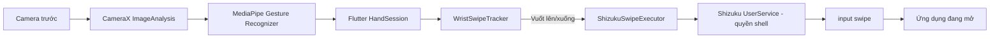

<p align="center">
  
</p>

<h1 align="center">AirSwipe</h1>

<p align="center"><strong>Điều khiển vuốt màn hình Android bằng cử chỉ tay — không cần chạm.</strong></p>

AirSwipe dùng camera trước và MediaPipe Gesture Recognizer để nhận diện lòng bàn tay mở. Khi bạn di chuyển cổ tay lên hoặc xuống, ứng dụng thực hiện thao tác vuốt tương ứng trên toàn hệ thống thông qua **Shizuku**. Nhờ đó bạn có thể lướt TikTok, Facebook Reels, YouTube Shorts… khi đang bận tay hoặc không muốn chạm màn hình.

> **Không cần root.** AirSwipe chỉ cần Shizuku đang chạy và được cấp quyền.

## Tính năng

- Nhận diện cử chỉ tay theo thời gian thực bằng MediaPipe Tasks Vision (chỉ nhận lòng bàn tay mở).
- Vuốt lên/xuống trên mọi ứng dụng đang mở thông qua Shizuku (lệnh `input swipe`).
- Tùy chỉnh độ nhạy, khoảng nghỉ giữa hai lần vuốt và chế độ chỉ vuốt lên.
- Ô Quick Settings để bật/tắt nhanh (thêm trực tiếp từ app trên Android 13+).
- Foreground service camera kèm thông báo khi đang lắng nghe.
- Chế độ gỡ lỗi: xem trước camera, skeleton bàn tay, FPS và độ trễ.
- Cài đặt được lưu lại giữa các lần mở app.
- Hỗ trợ Android 7.0 (API 24) trở lên.

## Yêu cầu

| Thành phần | Yêu cầu |
| --- | --- |
| Hệ điều hành | Android 7.0+ (API 24+) |
| Phần cứng | Camera trước |
| Ứng dụng phụ | [Shizuku](https://shizuku.rikka.app/) đang chạy |
| Quyền | Camera, thông báo |
| Android 13+ | Cần cho nút "Thêm lối tắt nhanh" trong app |

## Cài đặt

### Từ mã nguồn

Yêu cầu: Flutter SDK (Dart `^3.13.5`), Android SDK, JDK 17.

```bash
git clone https://github.com/phamhuulocforwork/air-swipe.git
cd air-swipe
flutter pub get
flutter build apk --release
```

APK nằm tại `build/app/outputs/flutter-apk/app-release.apk`.

```bash
adb install -r build/app/outputs/flutter-apk/app-release.apk
```

Chạy trực tiếp khi phát triển:

```bash
flutter run
```

> Bản release hiện được ký bằng debug key để tiện cài đặt cá nhân. Nếu phát hành chính thức, hãy cấu hình signing riêng trong `android/app/build.gradle.kts`.

### Từ bản phát hành

Tải APK ở mục [Releases](https://github.com/phamhuulocforwork/air-swipe/releases) (nếu có), sau đó cài như ứng dụng Android thông thường. Trên Android 13+, bạn có thể cần bật "Cho phép cài đặt ứng dụng không rõ nguồn gốc" cho trình quản lý tệp hoặc trình duyệt.

## Thiết lập Shizuku

AirSwipe dùng Shizuku để chạy lệnh vuốt với quyền shell. Nếu Shizuku chưa chạy, app vẫn nhận diện được cử chỉ nhưng **không thể vuốt**.

1. Cài **Shizuku** từ [Google Play](https://play.google.com/store/apps/details?id=moe.shizuku.privileged.api) hoặc [GitHub](https://github.com/RikkaApps/Shizuku/releases).
2. Khởi động Shizuku:
   - **Android 11 trở lên:** bật Tùy chọn nhà phát triển → Gỡ lỗi không dây, mở Shizuku và làm theo hướng dẫn ghép nối.
   - **Android 10 trở xuống:** kết nối máy với máy tính qua ADB rồi chạy:

     ```bash
     adb shell sh /storage/emulated/0/Android/data/moe.shizuku.privileged.api/start.sh
     ```

   - **Máy đã root:** Shizuku có thể khởi động trực tiếp.
3. Mở AirSwipe → bấm **Yêu cầu quyền Shizuku** → **Cho phép**.
4. Kiểm tra dòng **Shizuku** trong app hiển thị **Đã cấp**.

> Shizuku sẽ dừng sau khi khởi động lại máy (trừ khi dùng root). Khi đó hãy mở Shizuku và bấm Start lại.

## Hướng dẫn sử dụng

1. Mở AirSwipe và cấp quyền **camera** cùng **thông báo** khi được hỏi.
2. Cấp quyền Shizuku như phần trên.
3. Bấm nút tròn **Bật**. App chuyển sang trạng thái **Đang bật**, camera trước bắt đầu hoạt động và có thông báo "Đang lắng nghe cử chỉ".
4. Mở ứng dụng cần lướt (TikTok, Reels, Shorts…).
5. Giơ lòng bàn tay mở về phía camera trước, cách khoảng 30–60 cm.
6. Di chuyển **cổ tay** lên hoặc xuống dứt khoát:
   - **Tay đi lên** → vuốt lên → video tiếp theo.
   - **Tay đi xuống** → vuốt xuống → video trước đó (nếu không bật "Chỉ vuốt lên").
7. Tắt khi không dùng: mở AirSwipe bấm **Đang bật**, hoặc dùng ô Quick Settings.

Mẹo để nhận diện ổn định:

- Đảm bảo đủ sáng và tay tương phản với nền.
- Giữ bàn tay trong khung hình camera trước.
- Cử chỉ cần dứt khoát; hệ thống chỉ lấy mẫu trong cửa sổ khoảng 350 ms.
- Chỉ **lòng bàn tay mở** mới kích hoạt. Nắm tay, giơ một ngón hoặc vẫy tay nhẹ sẽ không có tác dụng.
- Chờ hết khoảng nghỉ (mặc định 1,5 giây) trước lần vuốt tiếp theo.

> Camera trước sẽ bị AirSwipe chiếm dụng khi đang bật. Tắt AirSwipe trước khi dùng ứng dụng cần camera khác (gọi video, chụp ảnh…).

### Ô Quick Settings

- **Android 13+:** bấm **Thêm lối tắt nhanh** trong app, sau đó mở bảng Quick Settings và chạm ô **AirSwipe** để bật/tắt.
- **Android 12 trở xuống:** mở bảng Quick Settings → chỉnh sửa ô → kéo **AirSwipe** vào danh sách.

Khi bật từ ô Quick Settings, AirSwipe mở lên một nhịp rồi tự thu nhỏ để bạn quay lại ứng dụng đang dùng.

## Tùy chỉnh

| Tùy chọn | Phạm vi | Mặc định | Mô tả |
| --- | --- | --- | --- |
| Độ nhạy cử chỉ | 0.08 – 0.40 | 0.18 | Ngưỡng dịch chuyển cổ tay. Kéo sang phải để nhạy hơn (ngưỡng thấp hơn), sang trái để ổn định hơn. |
| Khoảng nghỉ giữa 2 lần vuốt | 0.8 – 3.0 giây | 1.5 giây | Thời gian chờ tối thiểu giữa hai thao tác vuốt. |
| Chỉ vuốt lên | Bật / Tắt | Tắt | Bỏ qua cử chỉ vuốt xuống để tránh chuyển nhầm về video trước. |

Cài đặt được lưu tự động và giữ nguyên sau khi khởi động lại app.

## Chế độ gỡ lỗi

Chạm **5 lần liên tiếp** vào chữ **AirSwipe** ở đầu màn hình để bật/tắt chế độ gỡ lỗi. Khi bật, app hiển thị:

- Preview camera trước.
- Skeleton bàn tay đang được nhận diện.
- FPS, độ trễ xử lý và trạng thái phát hiện tay.

Xem log chi tiết:

```bash
adb logcat -s AirSwipeGesture ShizukuSwipeExecutor
```

## Xử lý sự cố

| Hiện tượng | Cách khắc phục |
| --- | --- |
| Báo "Shizuku chưa chạy" | Mở app Shizuku, bấm Start (Wireless debugging) rồi quay lại AirSwipe. |
| Đã cấp quyền nhưng không vuốt | Kiểm tra camera đang bật, Shizuku hiển thị "Đã cấp", tay mở đúng và đủ sáng. Thử tăng độ nhạy. |
| Camera không mở | Kiểm tra quyền camera; đóng ứng dụng khác đang dùng camera; tắt rồi bật lại AirSwipe. |
| Vuốt nhầm hướng | Bật **Chỉ vuốt lên**, giảm độ nhạy hoặc tăng khoảng nghỉ. |
| App bị dừng khi chạy nền | Tắt tối ưu pin cho AirSwipe trong Cài đặt → Ứng dụng → Pin; khóa app trong trình quản lý tác vụ nếu dùng ROM tùy biến. |
| Không thấy ô Quick Settings | Android 13+: dùng nút trong app. Máy cũ hơn: thêm thủ công trong phần chỉnh sửa Quick Settings. |
| Shizuku mất quyền sau khi khởi động lại | Khởi động lại Shizuku và cấp quyền lại nếu cần. |

## Cách hoạt động



- **Camera:** foreground service `AirSwipeCameraService` giữ camera hoạt động khi app ở nền. CameraX yêu cầu khung hình 640×480 từ camera trước và xoay về đúng chiều.
- **Nhận diện:** MediaPipe Gesture Recognizer chạy ở chế độ `LIVE_STREAM`, tối đa 2 tay, chỉ gửi tối đa một khung hình mỗi ~80 ms. Kết quả gồm loại cử chỉ và 21 landmark bàn tay.
- **Phân tích cử chỉ:** `WristSwipeTracker` chỉ lấy landmark cổ tay khi cử chỉ là `Open_Palm`, so sánh vị trí trong cửa sổ 350 ms. Nếu dịch chuyển vượt ngưỡng độ nhạy, app xác định vuốt lên/xuống và áp dụng khoảng nghỉ.
- **Thực thi:** `ShizukuSwipeExecutor` gửi lệnh `input swipe` qua UserService chạy bằng quyền shell của Shizuku. Đường vuốt dọc giữa màn hình, từ 72% đến 28% chiều cao (hoặc ngược lại), kéo dài 250 ms. Phía native cũng giới hạn tối thiểu 400 ms giữa hai lần vuốt.
- **Bảo mật:** khung hình camera chỉ được xử lý trên thiết bị, không lưu và không gửi lên mạng.

> **Ghi chú cho người phát triển:** `AirSwipeAccessibilityService` vẫn còn trong manifest từ phiên bản cũ nhưng luồng vuốt hiện tại không sử dụng dịch vụ trợ năng; mọi thao tác vuốt đi qua Shizuku.

## Cấu trúc dự án

```text
lib/
├── main.dart                        # Khởi tạo app và theme
├── data/
│   ├── settings_store.dart          # Lưu/đọc cài đặt bằng SharedPreferences
│   └── swipe_platform.dart          # MethodChannel + model dữ liệu
├── domain/gesture/
│   └── wrist_swipe_tracker.dart     # Thuật toán nhận diện vuốt từ cổ tay
├── session/
│   └── hand_session.dart            # Nối sự kiện tay với thao tác vuốt
└── ui/
    └── test_screen.dart             # Màn hình chính, cài đặt, debug

android/app/src/main/kotlin/com/airswipe/air_swipe/
├── MainActivity.kt                  # Cầu nối Flutter ↔ Android
├── AirSwipeCamera.kt                # CameraX + MediaPipe
├── AirSwipeCameraService.kt         # Foreground service camera
├── AirSwipeChannels.kt              # MethodChannel dùng chung
├── ShizukuSwipeExecutor.kt          # Gọi lệnh vuốt qua Shizuku
├── ShellExecutorService.kt          # UserService chạy quyền shell
├── SwipePaths.kt                    # Tọa độ đường vuốt
├── AirSwipeTileService.kt           # Quick Settings tile
├── SkeletonOverlay.kt               # Vẽ skeleton bàn tay
└── PreviewFactory.kt                # Platform view cho preview camera

test/                                # Unit test cho settings, platform, tracker
```

## Phát triển

```bash
flutter pub get      # Cài dependency
flutter analyze      # Kiểm tra tĩnh
flutter test         # Chạy unit test
flutter run          # Chạy trên thiết bị/emulator có camera
```

Mô hình nhận diện nằm tại `android/app/src/main/assets/gesture_recognizer.task` (MediaPipe Gesture Recognizer). Nếu thay model, cập nhật đường dẫn trong `AirSwipeCamera.createRecognizer`.

Yêu cầu build Android: JDK 17, compileSdk 36, minSdk 24.

## Nhật ký thay đổi

Xem [CHANGELOG.md](CHANGELOG.md).

- **1.0.0 (25/11/2026):** Bản phát hành đầu tiên — nhận diện cử chỉ tay, vuốt qua Shizuku, ô Quick Settings, tùy chỉnh độ nhạy/khoảng nghỉ.

---

Được xây dựng với Flutter, CameraX, MediaPipe Tasks Vision và Shizuku.
